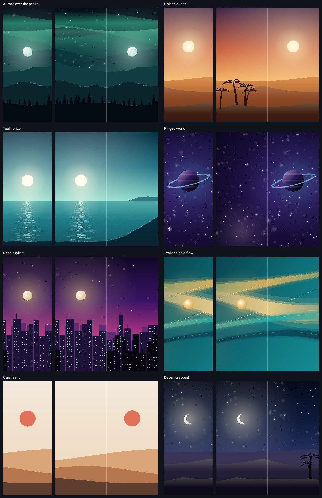
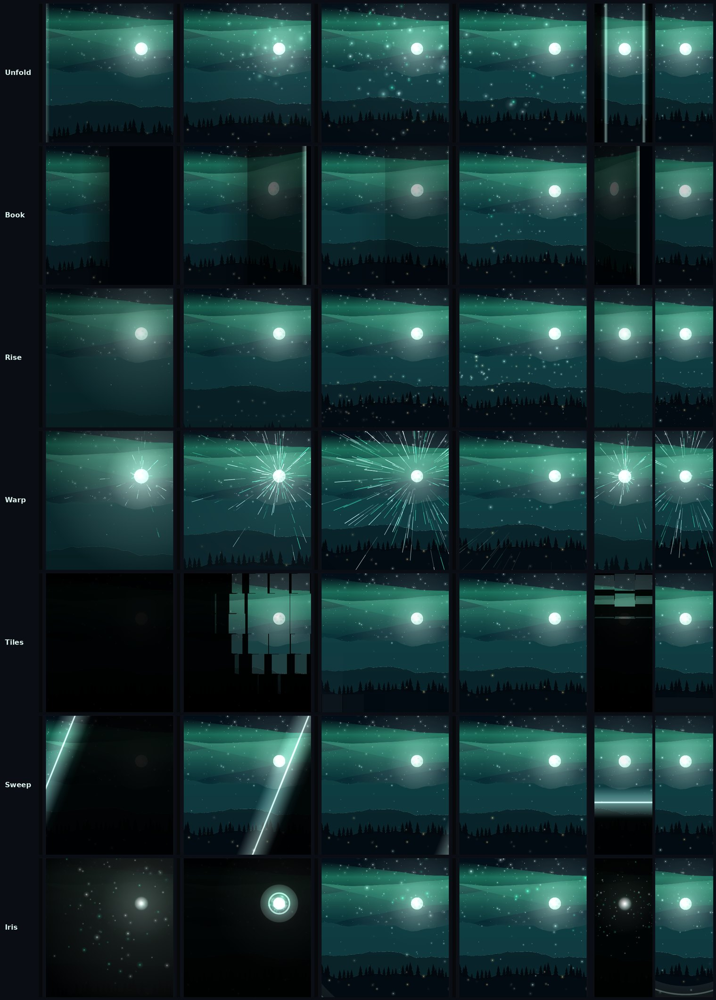
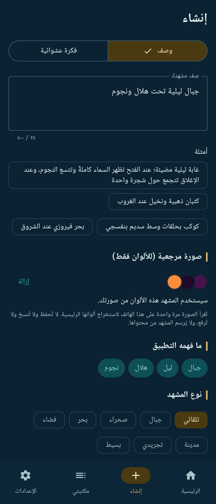

# Fold Motion Wallpapers

Live wallpapers made for Samsung Galaxy Z Fold: **one scene for both screens**, with a short
motion when the phone opens or closes.

خلفيات حية مصمّمة لهواتف Galaxy Z Fold: **مشهد واحد للشاشتين**، مع حركة قصيرة عند الفتح والإغلاق.

| Packs (cover · main, same physical scale) | 3D fold demo in the app |
|---|---|
|  |  |

**Seven fold animation styles** (each with an unfold and a fold variant; chosen automatically per
scene, picked when creating, or changed on any pack from its preview):
[comparison video](docs/motion/fold-styles-0.4.mp4)



Motion clips (unfold, living scene, fold): [showreel](docs/motion/fold-motion-0.3-showreel.mp4) ·
[aurora](docs/motion/aurora-peaks.mp4) · [ocean](docs/motion/teal-horizon.mp4) · [desert](docs/motion/desert-crescent.mp4) · [abstract](docs/motion/brand-flow.mp4)

| Home (Arabic, cover) | Create | Generating | Main screen (two-pane) |
|---|---|---|---|
|  |  |  |  |

## What it does

- **Live wallpaper engine** (`WallpaperService`) driven by a pure, unit-tested fold state machine.
  The cover shows a window onto the same picture the main screen shows in full, at the same
  physical scale (Fold7 panels are both ~151 mm tall; the cover is 48% as wide).
- **Fold choreography**: on unfold the scene opens outwards from exactly the slice the cover was
  showing, with a light blade on the moving edge, spring-settled depth layers and a burst of light;
  on fold, light spirals into the focal point and the scene opens from it as an iris.
- **Seven fold styles** (0.4): Unfold, Book (the right half swings flat in real perspective; the
  cover swings shut like a door), Rise (layers rise out of the dark one after another), Warp
  (stars streak, layers fly in), Tiles (tiles flip over in a wave; split-flap rows on the cover),
  Sweep (a band of light uncovers the scene) and Iris. Auto picks per scene and alternates by
  seed; any stored pack can be restyled in place (staged, re-validated, atomically swapped, the
  live wallpaper reloads).
- **Living motion** between folds: twinkling stars and shooting stars, glints on water, fireflies,
  drifting sand, flowing light, a breathing halo, layer sway and tilt parallax. 30 fps cap, stops
  when hidden, in power saving and with reduced motion; Full / Subtle / Off in Settings.
- **On-device pack generator**: a procedural illustrator (not an AI model, and the app says so) that
  understands a fixed Arabic/English vocabulary or picks from 20 curated ideas. Every pack goes
  through the blueprint's seven pipeline stages and the same validator an upload would.
- **FoldPack format** v1 with a JSON Schema, SHA-256 checksums, declarative motion and a
  hostile-input-safe importer (zip-slip, zip-bomb, wrong-media, path rules).
- **Official apply path** through the system live-wallpaper preview; success is verified on return.
- **Library** (created / imported / applied), share and import `.foldpack` files.
- **Fold Lab**: the proof-of-concept instrument. Logs engine lifecycle, surface sizes, display ids,
  hinge angle, state decisions and frame pacing; a built-in analyzer answers the feasibility
  questions (does the engine survive the switch, how early can the motion start, jank) with
  provisional GO/NO-GO marks, and exports everything for the Fold7 report.
- **Reference photo, colours only**: the photo is read once on the phone, its dominant colours
  become the scene palette, and nothing of the photo is stored or sent.
- Arabic and English, RTL, cover and main layouts, "night glass" design with an animated aurora,
  floating navigation and a 3D fold demo. No INTERNET permission, no account, no analytics.

Not in v0.1 (waiting for owner decisions, see the review §6): cloud AI generation, public gallery,
accounts, moderation.

## Documents

- [Blueprint review v1.1 (Arabic)](docs/BLUEPRINT_REVIEW_v1.1.md) — corrections, additions, status, open decisions.
- [FoldPack manifest JSON Schema](docs/schema/foldpack-manifest.v1.schema.json)
- [API contract draft (OpenAPI)](docs/api/openapi.yaml)
- [POC report template (Arabic)](docs/POC_REPORT_TEMPLATE.md)

## Build

Requirements: JDK 21, Android SDK with platform 37 and build-tools 36.

```bash
./gradlew :core:test :app:testDebugUnitTest   # 132 tests, Robolectric with real Skia rendering
./gradlew :app:assembleRelease                 # app/build/outputs/apk/release/app-release.apk
```

Tests write review images to `app/build/screenshots/`. CI (`.github/workflows/android.yml`)
runs the same steps and uploads the APKs and screenshots.

Signing: `signing/dev.keystore` is a **development** key committed so test builds install over each
other. Production builds read `FOLDMOTION_KEYSTORE`, `FOLDMOTION_KEYSTORE_PASSWORD`,
`FOLDMOTION_KEY_ALIAS` and `FOLDMOTION_KEY_PASSWORD` from CI secrets; use Play App Signing.

## Layout

```
core/   Pure Kotlin/JVM, no Android: device profiles, fold state machine, FoldPack model,
        validator and archive, motion spec and composer, scene composer, prompt interpreter.
        Runs unchanged on a server so device and backend reject the same packs.
app/    engine/     FoldWallpaperService, hinge monitor, shared fold session
        render/     SceneArtist (paints layers in world space), SceneDrawer (composites, shared
                    by engine and preview), SceneLoader
        generator/  LocalPackGenerator (GenerationProvider), GenerationController
        pack/       PackStore (atomic commit, quarantine import, export)
        apply/      ApplyController (system picker, verified result)
        telemetry/  PocTrace (Fold Lab)
        ui/         Compose screens, theme, components
docs/   Review, schema, API draft, screenshots
```

## Installing on a Fold7

Install the APK. On One UI 6+, **Auto Blocker** may refuse apps from outside the store:
Settings → Security and privacy → Auto Blocker → turn off while installing. Then create a pack,
tap Apply, and confirm with *Set wallpaper*. Use Settings → Fold Lab to record the device test.
