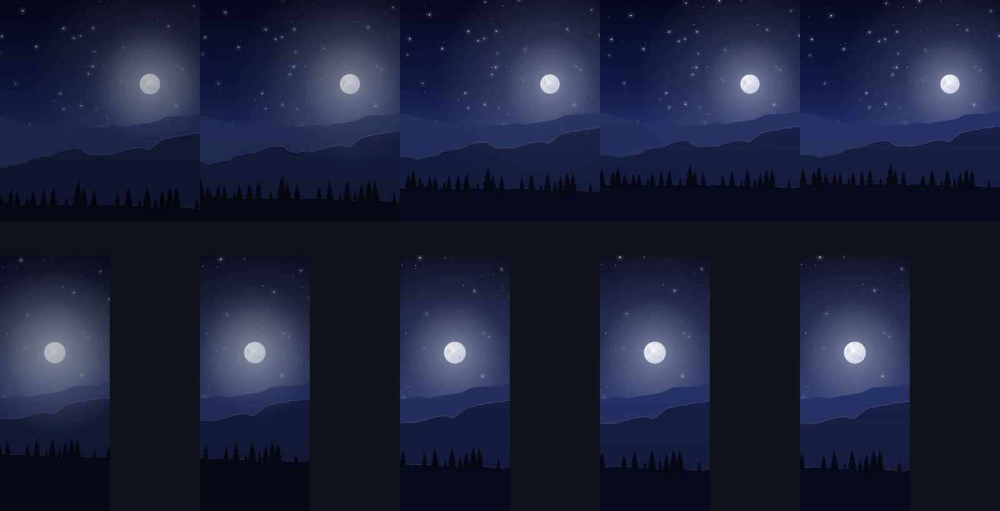
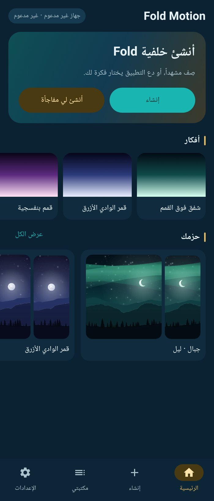
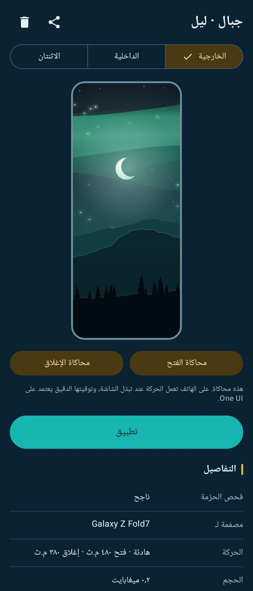
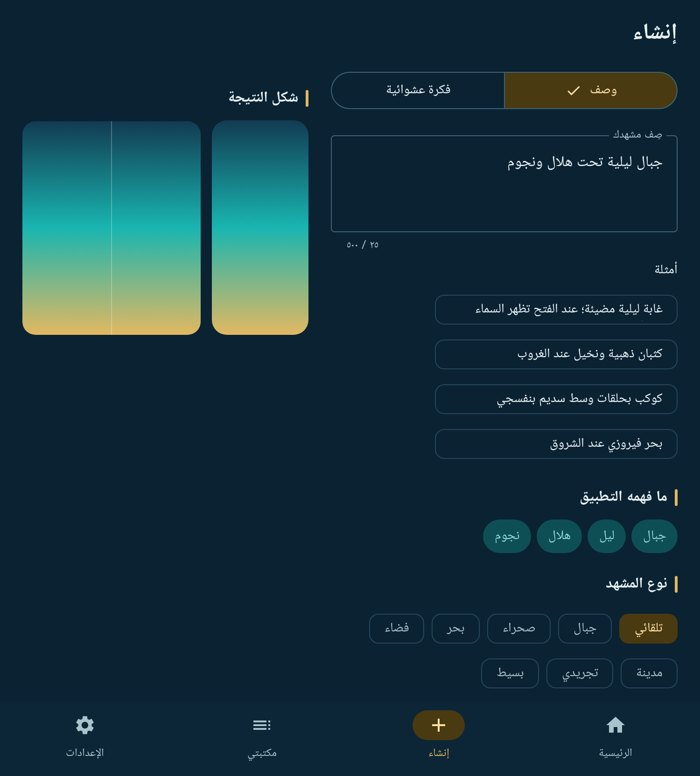
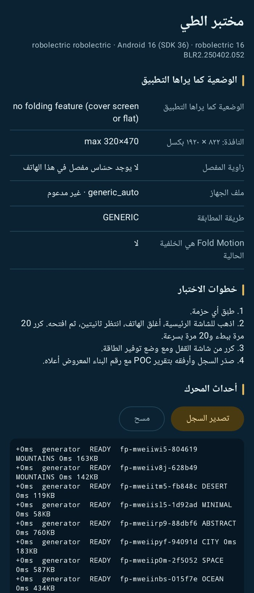

# Fold Motion Wallpapers

Live wallpapers made for Samsung Galaxy Z Fold: **one scene for both screens**, with a short
motion when the phone opens or closes.

خلفيات حية مصمّمة لهواتف Galaxy Z Fold: **مشهد واحد للشاشتين**، مع حركة قصيرة عند الفتح والإغلاق.

| Packs (cover · main, same physical scale) | Open / close motion |
|---|---|
|  |  |

| Cover screen (Arabic) | Preview | Main screen (two-pane) | Fold Lab |
|---|---|---|---|
|  |  |  |  |

## What v0.1 does

- **Live wallpaper engine** (`WallpaperService`) driven by a pure, unit-tested fold state machine.
  The cover shows a window onto the same picture the main screen shows in full, at the same
  physical scale (Fold7 panels are both ~151 mm tall; the cover is 48% as wide). Opening widens the
  view, closing gathers the light on the focal point. No frame loop except during a transition.
- **On-device pack generator**: a procedural illustrator (not an AI model, and the app says so) that
  understands a fixed Arabic/English vocabulary or picks from 20 curated ideas. Every pack goes
  through the blueprint's seven pipeline stages and the same validator an upload would.
- **FoldPack format** v1 with a JSON Schema, SHA-256 checksums, declarative motion and a
  hostile-input-safe importer (zip-slip, zip-bomb, wrong-media, path rules).
- **Official apply path** through the system live-wallpaper preview; success is verified on return.
- **Library** (created / imported / applied), share and import `.foldpack` files.
- **Fold Lab**: the proof-of-concept instrument. Logs engine lifecycle, surface sizes, display ids,
  hinge angle and state decisions; exports a trace for the Fold7 feasibility report.
- Arabic and English, RTL, cover and main layouts. No INTERNET permission, no account, no analytics.

Not in v0.1 (waiting for owner decisions, see the review §6): cloud AI generation, public gallery,
accounts, moderation.

## Documents

- [Blueprint review v1.1 (Arabic)](docs/BLUEPRINT_REVIEW_v1.1.md) — corrections, additions, status, open decisions.
- [FoldPack manifest JSON Schema](docs/schema/foldpack-manifest.v1.schema.json)
- [API contract draft (OpenAPI)](docs/api/openapi.yaml)

## Build

Requirements: JDK 21, Android SDK with platform 37 and build-tools 36.

```bash
./gradlew :core:test :app:testDebugUnitTest   # 81 tests, Robolectric with real Skia rendering
./gradlew :app:assembleRelease                 # app/build/outputs/apk/release/app-release.apk
```

Tests write review images to `app/build/screenshots/`. CI (`.github/workflows/android.yml`)
runs the same steps and uploads the APKs and screenshots.

Signing: `signing/dev.keystore` is a **development** key committed so test builds install over each
other. Production builds read `FOLDMOTION_KEYSTORE`, `FOLDMOTION_KEYSTORE_PASSWORD`,
`FOLDMOTION_KEY_ALIAS` and `FOLDMOTION_KEY_PASSWORD` from CI secrets; use Play App Signing.

## Layout

```
core/   Pure Kotlin/JVM, no Android: device profiles, fold state machine, FoldPack model,
        validator and archive, motion spec and composer, scene composer, prompt interpreter.
        Runs unchanged on a server so device and backend reject the same packs.
app/    engine/     FoldWallpaperService, hinge monitor, shared fold session
        render/     SceneArtist (paints layers in world space), SceneDrawer (composites, shared
                    by engine and preview), SceneLoader
        generator/  LocalPackGenerator (GenerationProvider), GenerationController
        pack/       PackStore (atomic commit, quarantine import, export)
        apply/      ApplyController (system picker, verified result)
        telemetry/  PocTrace (Fold Lab)
        ui/         Compose screens, theme, components
docs/   Review, schema, API draft, screenshots
```

## Installing on a Fold7

Install the APK. On One UI 6+, **Auto Blocker** may refuse apps from outside the store:
Settings → Security and privacy → Auto Blocker → turn off while installing. Then create a pack,
tap Apply, and confirm with *Set wallpaper*. Use Settings → Fold Lab to record the device test.
