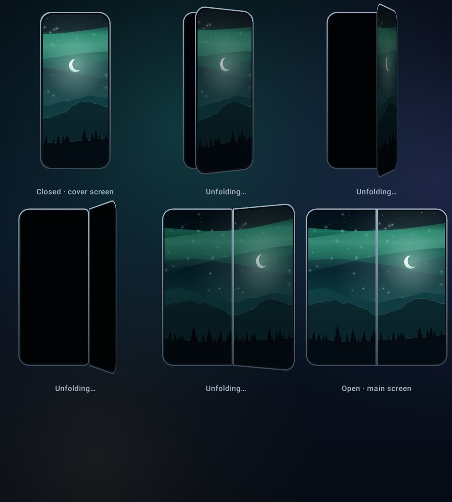
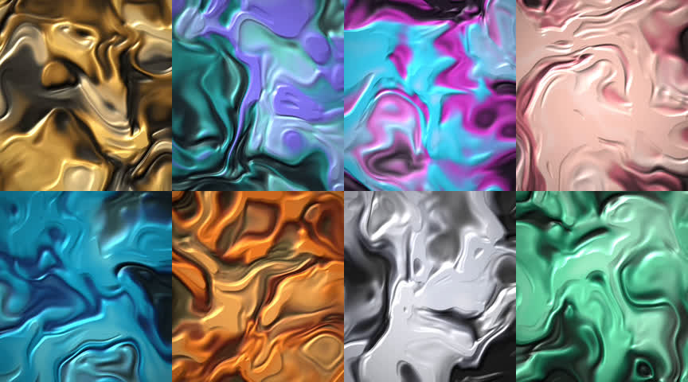
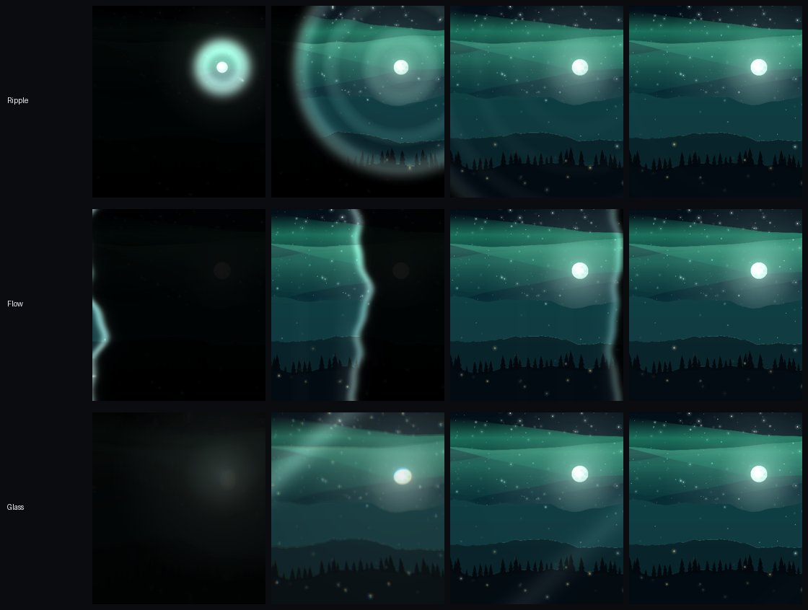
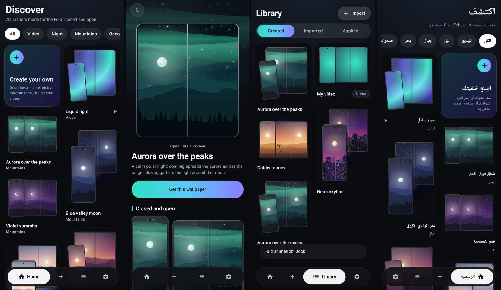
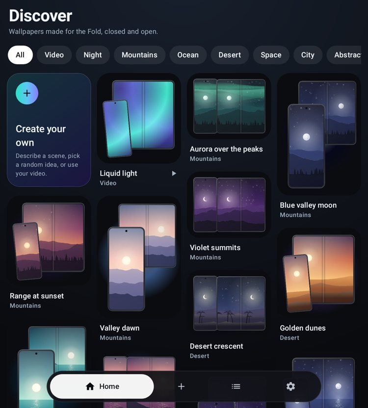
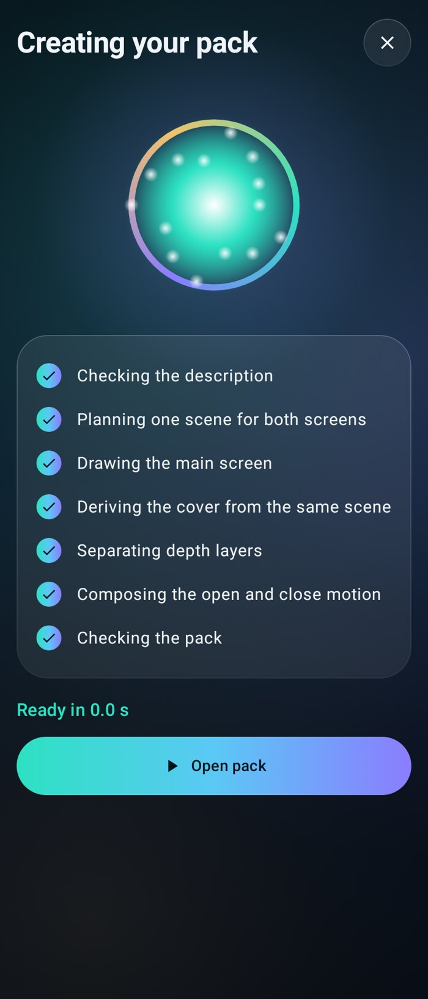
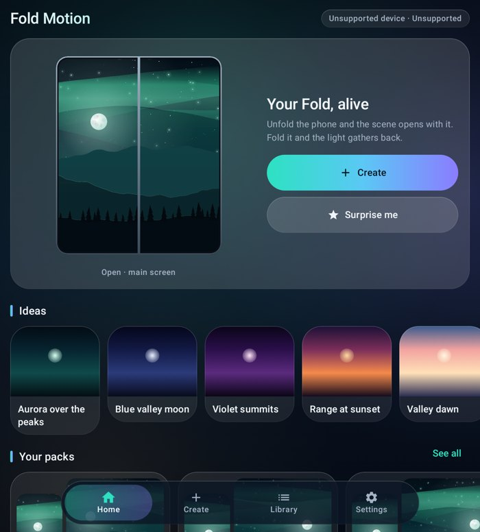

# Fold Motion Wallpapers

Live wallpapers made for Samsung Galaxy Z Fold: **one scene for both screens**, with a short
motion when the phone opens or closes.

خلفيات حية مصمّمة لهواتف Galaxy Z Fold: **مشهد واحد للشاشتين**، مع حركة قصيرة عند الفتح والإغلاق.

| Packs (cover · main, same physical scale) | 3D fold demo in the app |
|---|---|
|  |  |

**0.9.1: Real places, alive.** Twenty realistic live wallpapers, computed on the phone and
moving with the fold like the glass: four **oceans** (the sun or moon rises over rolling waves
as you open the phone), four **skies** (the clouds part around the sun and drift away), four
**auroras** over a mountain lake (the lights unfurl across the sky), four **rainy windows** over
city lights (the fogged glass clears) and four **planets** seen from orbit (sunrise sweeps
across them). Discover now holds 48 wallpapers, with a new Sky filter, and the promo shows them.
Fixes: unlocking without folding plays the animation again (Samsung reports "locked" for a
moment after the unlock; that stale reading no longer swallows it, and the lock screen going
away counts as an unlock even if the broadcast is late); the lock screen is now completely still
until you unlock; the wallpaper redraws on every rotation and the trace records each one.

| Promo (vertical) | Play screenshots |
|---|---|
| [fold-motion-promo-0.9.1-en.mp4](docs/promo/fold-motion-promo-0.9.1-en.mp4) · [AR](docs/promo/fold-motion-promo-0.9.1-ar.mp4) | [docs/store/screenshots](docs/store/screenshots) |

**0.9: The motion is in the picture.** Every wallpaper now moves by itself instead of having an
effect laid over it. A new set of eight **liquid glass** wallpapers (in the spirit of the
phone's glass design): clear glass drops over soft colour fields that bend the colours behind
them, catch light on their rims and cast soft shadows. Closed, the drops gather on the cover
screen; as the phone opens they flow apart across the main screen from right to left, and they
merge back together when it closes. Tilt turns their light, taps make them ripple. The drawn
scenes play their **built-in motion** (NATURAL): their own layers glide and rise into place in
depth, with no darkness, light or particles on top, and the Discover preview now uses the real
layers so it moves exactly like the wallpaper. On the lock screen a wallpaper waits in the first
pose of its motion, so unlocking continues it without a jump. **Create is gone**: no more
describing or random scenes; the new **Add** tab takes your own photo (choose its motion, or
Auto lifts a person or pet out in 3D) or your own video (it plays as it is). The molten liquids
and the sample clip are retired (packs made with them still play).

**0.8.2: After unlock.** Like Samsung's own wallpapers, the fold animation no longer plays on the
lock screen: the wallpaper stays still there and the animation of the screen in use plays once
you unlock; folding or unfolding an unlocked phone plays straight away. Settings > Play after
unlocking turns it off.

**0.8.1: Right to left.** On the Fold the front panel (with the cover screen) swings from right
to left as the phone opens, so now every opening does too: the 3D fold demo swings the left panel,
Book turns the left half like a page, Unfold, Tiles, Sweep and Flow travel from the right edge,
and folding runs left to right. Scenes put the cover's slice over the right half, where the closed
phone lies. Wallpapers made with older versions get the new motion when loaded (nothing on disk
changes; imported packs keep theirs). Plus a round of fixes from a full review (see the review
document, 9.7).

**0.8: Live.** The liquid wallpapers are now computed live on the GPU instead of played from
videos: they never repeat, drift when you tilt the phone, ripple where you tap the home screen and
pool along the fold when the phone is half open (and the APK is a third smaller: the 23 MB of clips are gone). Create >
Liquid makes your own from 8 looks, 3 paces and 3 wave sizes, with a live preview. **3D photos**:
pick a photo of a person, pet or car; a model running on the phone (no upload) lifts the subject
in front of its background so it moves in 3D with tilt and rises out of the picture when you
unfold. Plus a tester kit (in-app *Report a problem*, test plan, recruitment posts), framed Play
screenshots, a vertical promo video and a premium proposal.

**0.7: Liquid.** Eight new liquid wallpapers (molten gold, aurora silk, liquid chrome, deep
ocean...) that flow across both screens in loops with no seam, three liquid fold effects that bend
the picture itself on the GPU (Ripple, Flow, Glass), a new app icon, a calmer and consistent
design, and a Play Store release kit ([checklist](docs/store/PLAY_RELEASE.md) ·
[privacy policy](docs/PRIVACY.md)).

| Liquid wallpapers (first frames) | Liquid fold effects: Ripple · Flow · Glass |
|---|---|
|  |  |

**0.6: Discover**, a Pinterest-style wall where every wallpaper is shown on the closed and the
open Fold7; tap one to see it fold and unfold live in any style, then make it yours in one tap.

| Discover · detail · library · Arabic (cover screen) | Discover on the open main screen |
|---|---|
|  |  |

**Ten fold animation styles** (each with an unfold and a fold variant; chosen automatically per
scene, picked when creating, or changed on any pack from its preview). The original seven:
[comparison video](docs/motion/fold-styles-0.4.mp4) · **video wallpaper with fold styles:**
[demo](docs/motion/video-wallpaper-0.5.mp4)


Motion clips (unfold, living scene, fold): [showreel](docs/motion/fold-motion-0.3-showreel.mp4) ·
[aurora](docs/motion/aurora-peaks.mp4) · [ocean](docs/motion/teal-horizon.mp4) · [desert](docs/motion/desert-crescent.mp4) · [abstract](docs/motion/brand-flow.mp4)

| Home (Arabic, cover) | Create | Generating | Main screen (two-pane) |
|---|---|---|---|
|  |  |  |  |

## What it does

- **Live wallpaper engine** (`WallpaperService`) driven by a pure, unit-tested fold state machine.
  The cover shows a window onto the same picture the main screen shows in full, at the same
  physical scale (Fold7 panels are both ~151 mm tall; the cover is 48% as wide).
- **Fold choreography**: on unfold the scene opens outwards from exactly the slice the cover was
  showing, with a light blade on the moving edge, spring-settled depth layers and a burst of light;
  on fold, light spirals into the focal point and the scene opens from it as an iris.
- **Seven fold styles** (0.4): Unfold, Book (the right half swings flat in real perspective; the
  cover swings shut like a door), Rise (layers rise out of the dark one after another), Warp
  (stars streak, layers fly in), Tiles (tiles flip over in a wave; split-flap rows on the cover),
  Sweep (a band of light uncovers the scene) and Iris. Auto picks per scene and alternates by
  seed; any stored pack can be restyled in place (staged, re-validated, atomically swapped, the
  live wallpaper reloads).
- **Liquid fold effects** (0.7, renderer 5): Ripple (a drop lands on the focal point and the scene
  spreads out with the rings, which refract the picture as they pass), Flow (the scene pours in as
  a thick liquid with a wavy, glossy front) and Glass (the scene clears from behind melting,
  frosted, chromatic glass). The frame is recorded into a RenderNode and bent by an AGSL
  RuntimeShader as its RenderEffect, on the GPU; Android 11-12 and software canvases get a drawn
  cousin (iris, sweep, fade). Tests render them through the real HWUI pipeline.
- **Liquid glass** (0.9, renderer 7): up to six capsules melted together with a polynomial
  smooth minimum in an AGSL shader (the blend also carries each drop's slope and the way to its
  axis, so one pass gives distance, normal and lens offset), over an inverse-distance colour field.
  Inside, the field is magnified towards each drop's axis and bent hard at the rim with a little
  dispersion; the rim catches a key and a back light, and each drop casts a soft shadow with a
  faint caustic. `GlassLayout` (core, pure) places the drops each frame: gathered inside the cover
  window, spread over the main screen, one after another on a spring by travel distance, drifting
  on whole turns per 10 minutes, shifted by tilt with depth parallax, drawn towards the crease
  when half open. The fold progress drives them, so they are the fold animation; rendered at 1/1.6
  resolution for crisp rims.
- **Live scenes** (0.9.1, renderer 8): ocean, sky, aurora, rain and space, each an AGSL shader
  in world space (`LiveScenes`), driven by one `open` value from the same spring as the glass, so
  the place itself is the fold animation. Ocean: a pinhole camera over a plane of eight swells on
  whole-turn frequencies plus fine ripples, Fresnel reflection of a sky with a perspective cloud
  deck, the sun's glitter path. Sky: a domain-warped cloud deck lit towards the sun, parting
  around it. Aurora: ribbons with rays over ridged mountains and a forest, mirrored in a lake.
  Rain: three layers of bokeh, still and running drops that act as lenses, fog that clears.
  Space: a textured sphere with atmosphere, terminator and night lights, and a sun over its
  limb. Living motion runs at 30 fps for scenes.
- **Built-in motion** (0.9, NATURAL style, renderer 7): no reveal, overlay or particles. Opening,
  the backdrop settles from a slight zoom on the cover's part and the layers in front glide in
  from the right and rise, nearer ones further and later (never past their hidden margin);
  closing, from the left. Glass keeps its layers still and lets the drops move. The lock screen
  shows progress 0 of the screen's entry motion while waiting for the unlock.
- **Live liquid** (0.8, renderer 6): domain-warped gradient noise lit as a glossy height field,
  in an AGSL shader drawn into a low-resolution compositing RenderNode each frame and composited
  under the layer's pose, so every fold style plays over it. World-space, so cover and main show
  one continuous liquid; time runs on circles of whole turns per 10 minutes (exactly periodic,
  precision-safe). Tilt drifts it (bounded leaky integrator), launcher taps (`COMMAND_TAP`) send
  ripples, the hinge angle pools it along the fold. Posters (time 0) are rendered on the GPU
  offscreen (HardwareRenderer + ImageReader) for Android 11-12, motion off and thumbnails. The 0.7
  loop generator stays in `tools/liquid/liquid.py`.
- **3D photos** (0.8): DeepLab v3 (bundled, 2.7 MB) on LiteRT finds people, pets and vehicles;
  the subject becomes a front layer (depth 1) and the background gets its hole filled by push-pull
  averaging; tilt parallax is three times a drawn scene's, and Auto picks Rise so the subject lifts
  out on unfold. An ordinary renderer-3 pack.
- **Video wallpapers** (0.5): make a wallpaper from your own clip (trimmed to up to 15 s and
  resized on the phone with Media3 Transformer, sound removed, nothing uploaded) or try the
  built-in *Liquid light* sample. One clip feeds both screens: the inner screen shows a window
  of it, the cover a slice of that window at the same physical scale. Hardware decoding into a
  GPU texture, cropped per screen into hardware bitmaps that the normal renderer draws as the
  back layer, so all seven fold styles, light and particles play on top of the video. Two players
  cross-fade at the loop seam so any clip loops without a jump; video pauses when hidden, in
  power saving, with reduced motion or Living motion off.
- **Smoothness**: fold animations ask the display for its full refresh rate (120 Hz on the
  Fold7) and use a clock that pauses through stalls instead of skipping; video asks for its own
  frame rate; living motion runs at 60 fps on Full; the live wallpaper decodes layers straight
  into GPU memory so the first frames of an unfold never wait for an upload.
- **Living motion** between folds: twinkling stars and shooting stars, glints on water, fireflies,
  drifting sand, flowing light, a breathing halo, layer sway and tilt parallax. 30 fps cap, stops
  when hidden, in power saving and with reduced motion; Full / Subtle / Off in Settings.
- **On-device pack generator**: a procedural illustrator (not an AI model) that draws the 20
  curated scenes of Discover in depth layers (since 0.9 it is no longer offered for describing
  scenes). Every pack goes
  through the blueprint's seven pipeline stages and the same validator an upload would.
- **FoldPack format** v1 with a JSON Schema, SHA-256 checksums, declarative motion and a
  hostile-input-safe importer (zip-slip, zip-bomb, wrong-media, path rules).
- **Official apply path** through the system live-wallpaper preview; success is verified on return.
- **Library** (created / imported / applied), share and import `.foldpack` files.
- **Fold Lab**: the proof-of-concept instrument. Logs engine lifecycle, surface sizes, display ids,
  hinge angle, state decisions and frame pacing; a built-in analyzer answers the feasibility
  questions (does the engine survive the switch, how early can the motion start, jank) with
  provisional GO/NO-GO marks, and exports everything for the Fold7 report.
- **Reference photo, colours only**: the photo is read once on the phone, its dominant colours
  become the scene palette, and nothing of the photo is stored or sent.
- Arabic and English, RTL, cover and main layouts, "night glass" design with an animated aurora,
  floating navigation and a 3D fold demo. No INTERNET permission, no account, no analytics.

Not in v0.1 (waiting for owner decisions, see the review §6): cloud AI generation, public gallery,
accounts, moderation.

## Documents

- [Blueprint review v1.1 (Arabic)](docs/BLUEPRINT_REVIEW_v1.1.md) — corrections, additions, status, open decisions.
- [Publishing on Google Play](docs/store/PLAY_RELEASE.md) — what is ready, what the owner must do, listing texts, data safety and rating answers.
- [Privacy policy (English + Arabic)](docs/PRIVACY.md)
- [Fold7 test plan](docs/testing/FOLD7_TEST_PLAN.md) · [Finding testers](docs/store/TESTERS.md) · [Premium proposal](docs/store/PREMIUM_PLAN.md) · [Third-party notices](NOTICE.md)
- [FoldPack manifest JSON Schema](docs/schema/foldpack-manifest.v1.schema.json)
- [API contract draft (OpenAPI)](docs/api/openapi.yaml)
- [POC report template (Arabic)](docs/POC_REPORT_TEMPLATE.md)

## Build

Requirements: JDK 21, Android SDK with platform 37 and build-tools 36.

```bash
./gradlew :core:test :app:testDebugUnitTest   # 175 tests, Robolectric with real Skia and HWUI rendering
./gradlew :app:assembleRelease                 # app/build/outputs/apk/release/app-release.apk
./gradlew :app:bundleRelease                   # app/build/outputs/bundle/release/app-release.aab (for Play)
```

Tests write review images to `app/build/screenshots/`. CI (`.github/workflows/android.yml`)
runs the same steps and uploads the APKs, the App Bundle and the screenshots.

Signing: `signing/dev.keystore` is a **development** key committed so test builds install over each
other; it must never be used for Play. CI signs with the owner's upload key when the
`FOLDMOTION_KEYSTORE_BASE64`, `FOLDMOTION_KEYSTORE_PASSWORD`, `FOLDMOTION_KEY_ALIAS` and
`FOLDMOTION_KEY_PASSWORD` secrets are set; use Play App Signing (see the Play checklist).

## Layout

```
core/   Pure Kotlin/JVM, no Android: device profiles, fold state machine, FoldPack model,
        validator and archive, motion spec and composer, scene composer, prompt interpreter.
        Runs unchanged on a server so device and backend reject the same packs.
app/    engine/     FoldWallpaperService, hinge monitor, shared fold session
        render/     SceneArtist (paints layers in world space), SceneDrawer (composites, shared
                    by engine and preview), SceneLoader
        generator/  LocalPackGenerator (GenerationProvider), GenerationController
        pack/       PackStore (atomic commit, quarantine import, export)
        apply/      ApplyController (system picker, verified result)
        telemetry/  PocTrace (Fold Lab)
        ui/         Compose screens, theme, components
tools/  liquid/liquid.py (0.7 liquid loops), store/screenshots.py (framed Play screenshots),
        promo/promo.sh (captions and encoding for the promo video)
docs/   Review, schema, API draft, privacy policy, Play release kit, screenshots
```

## Installing on a Fold7

Install the APK. On One UI 6+, **Auto Blocker** may refuse apps from outside the store:
Settings → Security and privacy → Auto Blocker → turn off while installing. Then create a pack,
tap Apply, and confirm with *Set wallpaper*. Use Settings → Fold Lab to record the device test.

## Versioning

Releases go up in small steps (0.9.1, 0.9.2, 0.9.3...) and stay below 1.0 until the owner says
the app is ready; 1.0 is reserved for that moment. Every release bumps `versionCode` by one.
